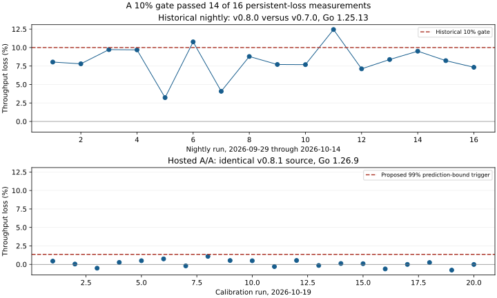

# Throughput investigation, 19 October 2026

The historical nightly comparisons show a persistent measured loss. The proposed nightly investigation trigger is 1.35%, derived from 20 current-release identical-source runs. Crossing 1.35% makes the harness exit nonzero and fails that nightly workflow, including on a noisy healthy run. A failure requires investigation; it does not itself attribute the loss to code. This does not accept the historical loss or establish a capacity guarantee.

## Historical observations

The 16 runs from 29 September through 14 October compared v0.8.0 (`9740e059ec175305f573b9d50fac7ee2c1e5ec00`) against v0.7.0 (`e92d2a570b80f4a6c77c371c89ff543c487e9e5d`) using Go 1.25.13. Their reported mean loss was 8.1575%, with sample standard deviation 2.24448 percentage points. The 10% gate failed 2 runs and passed 14: an effect below the gate can persist while most runs pass. These are rounded historical measurements, not identical-source controls.



## Current-release calibration

All 20 hosted workflows completed successfully. Candidate `fe544fbbb9f4472c74732728b2c778ceebefcf9a` is an empty commit over v0.8.1. Both checkouts have tree `dfabf6121cfea758097a617fa190c1d951370bc0`. The unchanged nightly harness used Go 1.26.9, concurrency 50, 15 seconds per proxy, concurrent candidate and baseline requests, and the shipped policies. The workflows also completed their load, overload, audit-chain and fuzz checks.

The first six runs were a pilot. The extension to 20 runs and the 99% investigation-trigger policy were recorded before the remaining 14 outcomes were collected. The originally considered 95% bound is also reported. No runs were removed.

For each run, let `x = ln(candidate valid-response count / baseline valid-response count)`. The mean was -0.0012494728993280842 and sample standard deviation was 0.004716024336577447. For n=20, the one-sided 99% Student-t prediction lower bound is:

```text
L = mean(x) - t(0.99, 19) * sd(x) * sqrt(1 + 1/20)
  = -0.013521492198524873
loss = 100 * (1 - exp(L)) = 1.3430487457946616%
trigger = ceil(loss * 100) / 100 = 1.35%
```

The 95% bound is 0.9559499279597428%, rounded upward to 0.96%. The arithmetic mean of the 20 per-run losses was 0.123814%, their standard deviation 0.471096 percentage points, and their range -0.777764% to 1.083414%.

The prediction calculation assumes independent, identically distributed normal log ratios. Twenty same-day shared-runner runs do not establish those assumptions or an operational 1% false-alarm rate. The current-release calibration uses a different toolchain from the historical comparisons and cannot retrospectively classify them against a validated noise distribution. Recalibrate when the toolchain, harness or runner changes; investigate a trigger before attributing it to code.

## Local historical screen and bisect

A separate local screen used Go 1.25.13, four pinned CPUs, GOMAXPROCS=4, concurrency 50, fresh proxies and the fixed current harness. Twelve randomized paired blocks compared new/new controls with v0.8.0/v0.7.0 comparisons. Only the relative comparison phase matches the nightly load settings; this was not the full hosted nightly workflow. The shared machine had concurrent work.

Subtracting the within-block control log ratio from the comparison log ratio gives a paired contrast corresponding to 13.2234% adjusted loss, with paired-bootstrap 95% interval 9.2427% to 17.6737%. This supports investigating a difference on that machine. It does not identify a cause or estimate hosted capacity.

A bounded adaptive bisect retained all raw results, including noisy classifications. Its nominal intervals are exploratory and do not control error across adaptive comparisons. The ten-candidate budget ended after 1796.5 seconds with five inconclusive skips and no isolated commit. The classifications are recorded in `bisect-summary.json`; classifications called good or bad mean below or above the declared effect boundary, not correct or defective code. A causal claim requires fresh confirmation.

## Decision and evidence

Do not accept the historical loss as harmless. Propose the calibrated trigger and corrected baseline-selection documentation, while keeping causal attribution unresolved until a controlled confirmation isolates it. No performance repair is justified by a noisy commit classification alone.

`hosted-analysis.json` includes every hosted run URL, exact counts and raw-log SHA-256. `historical16.json` retains the historical observations; `screen-analysis.json` retains the local screen calculations. `hosted-evidence.tar.gz` contains all 20 raw hosted logs and metadata; `reproduce_calibration.py` checks their hashes, counts, provenance and both prediction bounds. Complete local logs, scripts and review evidence are retained in the private task evidence directory `/tmp/cto-sweep-finish-20261019/throughput/` on the review host. Local paths are not a portable archive and must not be treated as independently accessible evidence.
